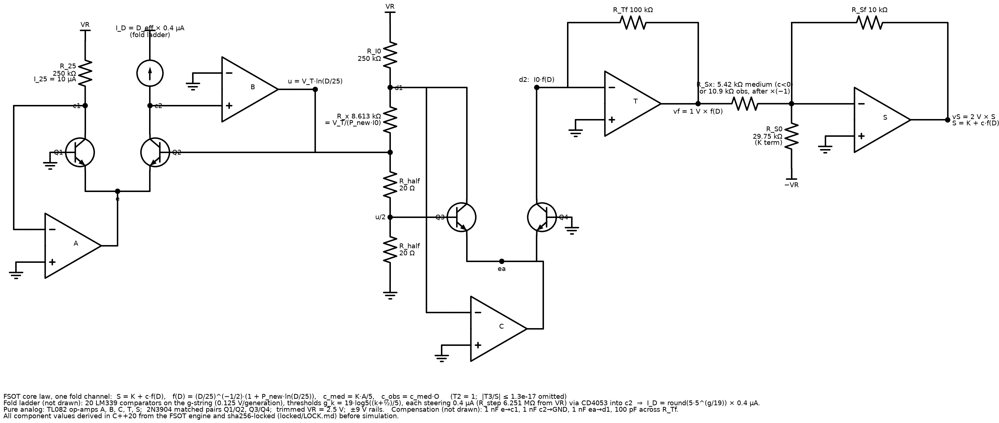
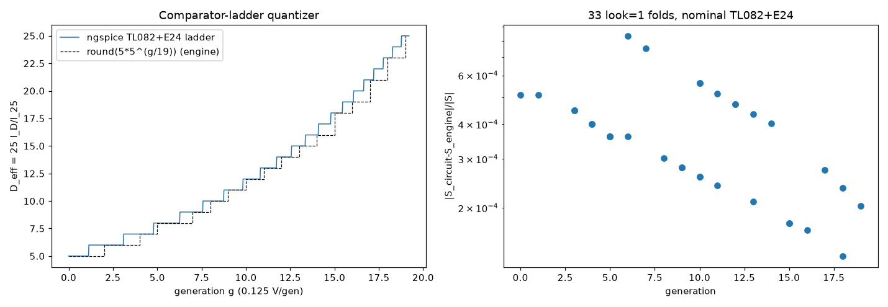

# FSOT Omni-Solver

An **analog circuit that computes Fluid Spacetime Omni-Theory (FSOT)**. The FSOT 2.1 scalar law and the quantities derived from it are realised as op-amps, matched transistors (log/antilog, translinear), resistors, capacitors, comparators and analog switches. The circuit itself settles to FSOT's numbers.

| | |
|--|--|
| **What it is** | DC analog computer: log-ratio / antilog / translinear blocks + comparator-ladder quantizer |
| **What it solves** | core law S = K(T1+T2+T3) for the fold channels, plus α_s, 1/α_em, Ω_b h², m_H/m_W (Phase 1 slice) |
| **FSOT authority** | [FSOT-2.1-Cpp @ 3466e8d](https://github.com/dappalumbo91/FSOT-2.1-Cpp/tree/3466e8d4211d786fa7a430de1ee75131fb3b2e97) (engine pin AEB2AD), hub [FSOT-2.1-Lean](https://github.com/dappalumbo91/FSOT-2.1-Lean) |
| **Digital parts** | **none**: no microcontroller, DAC/ADC or digital calibration |
| **Free parameters** | **0**. Every component value is derived in C++20 from the engine and sha256-locked before simulation |
| **Simulators** | ngspice (TI TL082 vendor macromodel, 2N3904 Gummel–Poon) and Falstad CircuitJS |
| **License** | [Apache License 2.0](LICENSE) |
| **Author** | Damian Arthur Palumbo |

**Status:** Phase 1 (vertical slice) is complete. Phase 2 is on branch `feat/phase2` (draft PR #1, not merged); see "Phase 2" below. Phase 2 covers a completeness audit of every engine term (observer/quirk modifier, T2, T3, all 35 folds), temperature tracking, precision models, and the insight log.

## What this is trying to do

FSOT derives a large set of physical numbers from five seeds (π, e, φ, γ, Catalan's G) with no fitted parameters. This repository asks: if you build that derivation as a physical apparatus, does the apparatus reproduce the numbers? Where it struggles, does that point back at the parts of FSOT that are hard to pin down?

The goal is a circuit Damian can eventually build on the bench. This repository holds it until then, and anyone can rerun every number.

How the circuit computes:
- **Voltages are FSOT quantities** on explicit scales. For example S is 2 V/unit, the generation input g is 0.125 V/generation, and 1/α is 0.04 V/unit.
- **Logs and exponentials** come from transistor junction physics: V_BE = V_T ln(I/I_S), with V_T = kT/q.
- **The nest rounding** D_eff = round(5·5^(g/19)) is a 20-comparator threshold ladder that steers unit currents.

## Try it live (Falstad, no install)

Each link is the core-law block (log-ratio → antilog → transimpedance amp → S summer) with the locked values. Press **RUN** and watch `vS` settle.

| fold | expected vS | link |
|---|---|---|
| Chemistry, D_eff = 6 (specimen) | 1.91058 V (S = 0.955289) | [open in Falstad](https://www.falstad.com/circuit/circuitjs.html?ctz=CQAgjCCsCmC0Ac4AMA6ATEpaDs2DMS8aAbAJynZRJRVRxhgBQASiACyIfuJjEjXU21NCkj9xqSIwyUucxMTbsQANwBOLcGDTctO3hPbVYIsQP6jpSSgx1dbIRcvUA7RmvDY+efV5Ck+ajAkNl5iYhRwqOjsKxs-H08+AyV1OKT-ZL8HJQBjNHcQNCEQROLqAPE0SExMFCR08tKdJpTVDRkiksrW7WVcpgAXUrw+NGLS4kRxpSDDYOoAE2gAMwBDAFcAG0HGAHcRsYmCJRn+RgBzUpCi45umgX3J6cJnjIbO0Z4EqfBiQRAAyeXy61BBOB0H2sbwhMPgnBA0EYa2uSiEYN+6JAiGwohAsFxYgWtXMQRJqAaBxOpXgp2wOjwtPOnVhjNOJTZ-SYVJuoTG9PYBgaV1hfKKArYiUeHhBWMldkw4mJ9XS8qMgiccsRjFyqOaesqQTgSFIEnqSCYnxuiWpbSRVqUlVtfTyTF1IJtv0N4GNpoE5st0I9DN+bXylzeTtDfUewzYPQmkDQ0wmc3MCxAy3W212B3jRzRTjOUNkRYmarOSg2TyTL0Qtfe6QbYD8zf+-QKBwbTW7ApLUGT4p03fhyiRKIbWMgpAV1BxeIJeOJtXm5JVXcHnPzNNmEe3W8qWMeG84KUPQtV574bE1YYKHmns8ckGvirJdX7xBf6sco611Y8Yhjh0IDHUCIoalqFVOlA-VYLaNIYImSp4JdTMmEA0dEimRBvXgYgwDwaDoRwuDRzaRZA0oUiUPItCAJAbAk31JidG9DBiMoViWOYtpq06bjKm4nIQAAIww7EDESeADHYil0hk7wdEUv5lHEiMVMqFSHFjZ8C1-FNZnAVcllWTYdieL99Ng4t0hsxMZ1uNExO5AyileUiW0COzyL8Tz2yUSjLNHJpSNhT8QoFMK-0RNZGGGFSzlpQylRMzMzJzJ5EombAmVsq5ctOHK8pKY9sS4DBEGSxtOmqrzyp4ALM07BrQVa8KFIqgVquTBFoDilFuKxFThsYhdCWQckTKgylGOYzl6TBJl+0Wnc3K3dCniGgxVrFYVGIwQU+F2qVzg8EbFXhQQ30m+Tavga6KhdRUlH6nVsQe-UrsyJVfTNTAqI+sFlM+u04vuio+G+kSgpRChXzJEpRomxciXJUlbo-J54bW0g2CUTl+zxgmmVIPoNsWFqcbFYmjvOK5aZp-H2FO2bgiRxVgglN90i5p8GF5F7VBWQpacSWnvWXO7oTFtjmYQkXOglvhaZhgpdQWRBEk1n6jVgYJ-otXnMC1-QTdU1JFehHXKh1tXkXADBqBfIISCUF3sTGsRUcxm73xmp5tEVSB5d4etmf7BhfhDpQGFGKBmaUFwVgAS0Dp2oGyMPM+8q4o-rLPo8csrtCcD3tEqD3I7QSv20IwcPcttwPD5-VW8lklOOQAVtesfRr2F42BVtvu9GUZO05bwilK0eOO4Dzo45npeLZACfeenn6V5ElQVmbx3FW1jOO9ILHF4zo-OYH3e3HPxVbYzkSXAAZ0KUuCf0N3daKChIDALv35ty-ghNQt9rZfwfk4J+r8W4+FNuAOB39lwAMQdrRBCEADKvNEG23QWhF+Dsg6PUdpqS6Xt8QTSlhjKW64D5LVjtnQmG9fichXhtAhBwiF03znTfaPCxT8NZunUhrtDw83PmIoIiCtQqCwQADwyIoDEChJTKDAEoAAYhggA8gAFQADrP1yAAezUHALYaw9iGNElsYxuQADWAAuQxABhAAFtAAAtinZ+gw1AAE9DEAAoAAiAB9VYKwAC8xAAA0hjn4AAdoC5BTp46ALgACUjAFH1WID3X4+SxCx1SBgwxUTDFoEMQANUMXIwxGCADchitF6MMRki4KcXDQGCS4wxiStgbCSYM5+mTnHPzKc-Cpz9UCkEgLWUghjYAAD5DGyPKYY-+ZMkCQHgDUxgQA) |
| Cosmology, D_eff = 25 (medium) | −1.00475 V (S = −0.502377) | [open in Falstad](https://www.falstad.com/circuit/circuitjs.html?ctz=CQAgjCCsCmC0Ac4AMA6ATEpaDs2DMS8aAbAJynZRJRVRxhgBQASiACyIfuJjEjXU21NCkj9xqSIwyUucxMTbsQANwBOLcGDTctO3hPbVYIsQP6jpSSgx1dbIRcvUA7RmvDY+efV5Ck+YUhMTBQQ8JC8Kxs-H08+AyV1aPj-BL8HJQBjNHcQNCEQOILqAPE0YJCwlJKinVrE1Q0ZfMKyhu1lLKYAFyK8PjQCouJEIaVqCHMwTBAAE2gAMwBDAFcAGx7GAHd+weGCJXH+RgBzIqQjg8vW8yQdkbHCR9T7loGeWNHwYkEQboeH1uLxwOje1hB2B0QLQ8E4IGgjGWFyUQmoQLRIEQ2FEIFgOLEMwihiJVXuu0ORXgRyhVImNVpeGpwKZqP+TApNzYBlB7AM93OvO5g1pbDiAjyGNmYrss0mZJSMqMgicmKUiKyKLqWrKkzgSFIEjCSCY7xucUpjURZqUZUtnWyTE1QIt3114H1hoExtNEJd0O+jRyZxedsDnQlfTY7WGkFh+WGkxJswWKw2W120f2qKcx3BslzwyVxyUqwecaeiArrxS1bAfjrvy6uV21dqbdp+ag8d5bbhykRyOrmMgpFl1GxuPxuNJIWT4WqrfjrPYduZAtX3mZWeVEnL8eFm75gUVZUPbFVQdyHlH48ckD4mPloS7xAfu9GnGlIDLHmIBx0f9bUCfJKhfFIgO1SDGmSFpILKaCHXmJg-37OJPzScR4GIMA8GqOC0MA-tGjmX1KAwhDiKQ38QGwONtTonR3QwfCIUYhj6MaMsWnYsp2MyEAACMUKxAw4ngAxmNQLsJO8HRZJ+ZRhJDBSygUhxI3vbNHH7PNwHneYljWTYHjfbTILzCDhmOW8EzZZTdgwjAFGIvxX1cvgMN4P5SNM3TCiczsIN02knP7dVlkYPoFOOakxkTfTphTIz0weGLhmwZlLPOTKriUXLgQlXY4vyZ4SvrE8WnKvxyqbJQ5hbLEuFqEreRk5raVa8KEUi5F2MxBSBtoqcCWQYkkoXclaPolcoXRdcUjmukdMQFd6o5aa7AMJbDw3HbtowdhxRODxBtmOFBDlMbpJSC7d1IB1v2gSLNTu8T4FKECwE9I1MDIrEPu1O6rUiqrAbUwGBN85EKEfWYZkKIbRunQkIjua7wN2WHltINglBXLtcfx5kHuhbd5ka7HDyJ48TnOGnqbxo6wROXYEcu+VRTlFIZi5yYEd3JJFjyGm4hp91ZxulpRaYpmYOF6WmbKGmodyTUiVW-RMEQCX6DuH0ee17UNcUoXDeeMoTdVvJtFmOJbc+8RIDYFiuwd42MEmR9VAViF3ctz29GUFwAGcbZIfH9AjzDhAoSAwFYmxo-t6OYLUNwWm0JwA6cATQ5tnxNfAQuY4xxPi+XfQS5ggBlHmS8t6ukPz5F3cxLPUXO4axBRjGrufBU2cDlcGG+Amed4VbmQYAZlqUfOh+lAxR84fkQxX2mN6VIrwGj9u0DPbnM4PuHJhLtVVDrgAPVJFHRb5FDwZQwCUAAxGuAHkABUAB0Q6yAA9moOA6xljbD-oJdYACsgAGsABcf8ADCACQ4AFsAFQNOAATz-gACgACIAH0liLAALwVAADR-1QdAOYABLVYqCACUjAb4VUcIyB+dFn5JBrn-Uhf80B-wAGp-yvn-GuABuP+79v5-2gC4U4dCXDQDwYgv+AAHdYqwQ5aJ0UwhBIc+EhwESHWAkgsB4FwH-WAAA+P+KhjGmNgAnTAbA6IiMYEAA) |
| Quantum Mechanics, D_eff = 5 (specimen) | 1.90039 V (S = 0.950197) | [open in Falstad](https://www.falstad.com/circuit/circuitjs.html?ctz=CQAgjCCsCmC0Ac4AMA6ATEpaDs2DMS8aAbAJynZRJRVRxhgBQASiACyIfuJjEjXU21NCkj9xqSIwyUucxMTbsQANwBOLcGDTctO3hPbVYIsQP6jpSSgx1dbIRcvUA7RmvDY+efV5Ck+am1ITEwUJCsbPx9PPgMldUjY-zi-ByUAYzR3EDQhEBi86gDxNBDQ8KSigp1q+NUNGVz8krrtZQymABcCvD40PILiRAGlIMMwTBAAE2gAMwBDAFcAGy7GAHde-sGCJVH+RgBzAqR93bPm8witvpHCIZ4-CKa75LfeQRBOzcerv5wOhe1gB2B0bzQ8E4IGgjAWpyUQmobyRIEQ2FEIFgGLEk1CU3MeIqNwRBXg+zBZLGVUpeHJ-zpiO+TFulzYBkB7AMEROnPZ-UpbBiAhyKKmQrsBOQYWBshiqLYTgVMMYGVJMT2KXEYDgSFIEnCSCYr0uGsu9VhJqUJU16WZqr+GuGWqCuv1AkNxpBbydPD4mWyJzeNudDhFPTYrUGkEhuUG40JU1mi1W6y2kZ2iKcB1l7GzgwlcaZS1+MfuiDLyVzlbAfhrxC+WVLseqlc51ZblLbUOUsPhldRkFIkuo6Mx2MxRNCE3xqBJlcZ7Bt9J5S+89IzRmuzc48RK-MOTU3B8ViPqTY8Q5Hjkg-qlRMqTWIt63jh7ypLHmIux03+tgVycoZSSP8akcQZ6kSJ9BhKUC7WmJgvx7GJhkQEpR2IMA8EfEFULAvD6gQkCe1gns7U-EBsBjMCqJ0dDcjnJJaJo6j6hLJpmJKZi7QAI0QtEDBieADHojAcMoYTvB0STwH9EA+OOAS+BKGSw0OHpn0zN8RnjcAZ2oZNljWX5NKLcDzmpaCLKgYczKUBStjwjAFDI55iKePgCIbZQiMcntqicylc0C39-PfGEFkYHoZIOckdLGPTEwM+YjLTJSzOwekc0UzLrNy-4RS2OKGMQYra0CJIyr8MrvKUaZsiKrhqmK9tKqaykWvC6BIvhZjURk-rKPHHFpXxfTiV+ZjFzBZEVyYjAqW0xa6pZSjqIPGauQqk5No2hbCxFDwBqmKFBHvCamlO19SHaZVuodK6hPgYoAJ1WA9QNTAvQk56wKui1Isu36VN++CmHhCg7yCM4ztHIaxAnXFZ2uUbgK2SHFtINglEXXMsZx+kbvBDcZga-w-APfGtsOE4qcp7H2GFQ4tkmfJUUmQUCSSDnrwYNlxVUOYcipmIqfoqdGKaEW6IZyChalhmSip+DsjVPFEBidWXXAehrk9bnMA1-RDdk5x5ZBLWSi1lW4XADBqFvIISCUR20XhrERollGJcqFn7agWXeArBncwYZ1IEDvoA6ZFw5gAS1+bQpkgNIg6gNyTjDitU-D2zCrtpxXe0EpXdDtAS+8rDY1dhI5jcDwebAxvxfxcTkFpY3KTlg3KSt6x9FukBY4ThusKkrQo5bi6LbHpvZ-qYfudnq358HlQ65yJPkX0f2W9IYCmi3pv-bltxD93uIT8HlwAGdN+d4+nFEihIDANvtCcTWH8gtQz4th+rbf2vnfBuPgjbgDAdrKc79IGa0gZBAAytzSBVt4HANtkfdmD9BojURqjKU0NW4kiPouLOi1Q5p1IbPRcShb6J39geMhB5VxMIMEwpmxDsFTGLlDQ8-99zcMgcqFQSCAAeyRFDImdIoPAygwBKAAGIIIAPIABUAA6N8MgAHs1BwBWAsDYmieIrG0RkAA1gALk0QARSWAsFwXQlgAFsAD6ABZaAGQAAWDi44ZBvpogAFAAEVcfMOYABeSAAAaTRN8AAOXi47OOgC4AAlIwcR5VHC0mkVRORCQEGaMiZotAmiABqmjRGaIQQAbk0UotRmi0lHDji4aAwSADCmiEkrCWIk-pN90nWJvsUm+pSb6oFICEMAFBNGwAAHyaJESUzRb995IDwKQSpjAgA) |

Verified headless: settled values agree with the C++ engine within 1.7e-4 (`falstad/falstad_check.json`).

| core-law block | fold ladder (quantizer) |
|---|---|
|  |  |

## Reproduce (one script)

```bash
sudo apt-get install -y g++ ngspice curl unzip git python3-mpmath python3-matplotlib
./reproduce.sh          # fetch engine at the pinned commit + TI model (sha256), verify LOCK, rederive, ngspice nominal, cross-check
./reproduce.sh --mc     # also the 600-draw Monte Carlo + 6000 fold decisions (~10 min on 8 cores)
```

`reproduce.sh` runs these checks:
1. It clones FSOT-2.1-Cpp at `3466e8d` and verifies HEAD.
2. It rebuilds the C++20 derivation and checks that the locked TSVs come out **byte-identical**.
3. It checks every sha256 recorded in [locked/LOCK.md](locked/LOCK.md).
4. It fetches the TI TL082 model and verifies its sha256 ([THIRD_PARTY.md](THIRD_PARTY.md)).
5. It reruns the ngspice nominal slice and fold staircase and compares them with the committed results.
6. It re-checks every target with an independent 50-digit mpmath implementation.

CI runs the same steps.

## Results (Phase 1, 27 °C)

Ngspice uses the TL082 vendor model with E24 resistor strings. Monte Carlo: 200 draws per class.
- **A**: TL082, 1% resistors, unmatched 2N3904.
- **B**: zero-drift op-amps, 0.1% resistors, matched pairs.
- **C**: B plus identity trims.

| quantity | C++ engine | ngspice nominal | MC σ (A / B / C) | measurement bar | meets bar (class C)? |
|---|---|---|---|---|---|
| S_quant | 0.950197 | 0.949713 | 5.3e-2 / 3.2e-3 / 5.7e-4 | 9e-4 (via m_H/m_W) | yes |
| S_chem | 0.955289 | 0.954861 | 5.1e-2 / 3.6e-3 / 5.6e-4 | 3.1e-4 (via Ω_b h²) | no |
| S_cosm | −0.502377 | −0.502275 | 1.2e-1 / 1.0e-2 / 1.1e-3 | 6.7e-3 | yes |
| m_H/m_W | 1.550837 | 1.549886 | 5.3e-2 / 3.2e-3 / 5.6e-4 | 9e-4 (PDG) | yes |
| Ω_b h² | 0.0224616 | 0.0226624 | 0.97 / 7.6e-2 / 9.1e-3 | 6.7e-3 (Planck 2018) | **no** |
| α_s(M_Z) | 0.1170997 | 0.1171457 | 5.7e-2 / 5.7e-3 / 5.9e-4 | 7.6e-3 (PDG) | yes |
| 1/α_em | 137.03620 | 136.9456 | 6.4e-2 / 6.5e-3 / 1.3e-3 | 1.5e-10 (CODATA) | **no** (analog ceiling ~1e-4) |

The fold ladder made 0 mis-rounds in 6000 Monte Carlo decisions. All 33 look=1 domains on the physical generation string match the engine with a median error of 3.6e-4 and a worst of 8.3e-4. Full tables, the error budget and the analysis are in [docs/PHASE1.md](docs/PHASE1.md) and [results/](results/).

## Phase 2 (branch `feat/phase2`, draft PR; not merged)

Everything is pure analog. Values are derived in C++20 (`phase2/cpp/derive2.cpp` against FSOT-2.1-Cpp @3466e8d) and locked before simulation (`phase2/locked/LOCK.md`, which records Amendments 1–4).

```bash
phase2/tools/reproduce2.sh /path/to/FSOT-2.1-Cpp   # LOCK2 check, Chemistry/Atomic/HEP folds, 1/α at 0/27/50 °C, Ω_b h² (CI job "phase2")
phase2/spice/fetch_models.sh                       # TI OPAx187 + LM139 (SHA-256 verified, not committed)
```

The table uses ideal op-amps and exact resistor values at 27 °C unless a row says otherwise.

| Quantity | Circuit | Engine | rel |
|---|---|---|---|
| S, 35/35 folds | – | – | −4.0e-4 … +1.9e-4 |
| D, 35/35 folds | exact | – | 0 |
| V_NEP (10 kT/q), 0/27/50 °C | – | – | 1.0e-5 / 7.1e-6 / 5.3e-6 |
| 1/α, 0/27/50 °C | 137.0628 / 137.0615 / 137.0607 | 137.0362 | +1.9e-4 / +1.85e-4 / +1.8e-4 |
| Ω_b h² (bar 6.7e-3) | 0.022395 | 0.022462 | −2.95e-3, pass |
| Ω_b h², E24 resistors | 0.022265 | – | −8.7e-3, fail |
| Ω_b h², E24 + OPA187 I_B | 0.022189 | – | −1.2e-2, fail |

The full results, the honest limits (vendor-model and MC convergence in ngspice, and bias-current sensitivity) and what is left are in `docs/INSIGHTS.md` and `docs/COMPLETENESS_AUDIT.md`.

## Honest limits

- **A bench-cheap build does not reproduce FSOT.** TL082 offset (3 mV) at junction-scale nodes and unmatched transistors (1 mV) give about 5% on S, and Ω_b h² is meaningless.
- **There is a ~2–6e-4 systematic floor** (Early effect, high injection, finite β, op-amp gain). The precision class reaches about 3 significant figures.
- **Ω_b h² = |S_cosm|(1−S_chem) amplifies S_chem errors about 21×.** It misses the Planck bar even in class C.
- **1/α_em cannot be checked against CODATA by any analog circuit.** The bar is 1.5e-10, and the FSOT–CODATA difference is 1.5e-6.
- **Temperature is not yet compensated in Phase 1.** At 0 °C the circuit reads 1/α = 184; at 50 °C it reads 110. Phase 2 adds a PTAT exponent reference and an analog oven.
- **The Phase 1 slice does not yet build every engine term as a block.** In particular:
  - the observer/quirk modifier is a locked resistor ratio (c_obs = c_med·O);
  - T2 = 1 is a reference current;
  - T3 (≤ 1.3e-17 relative) is omitted;
  - the Atomic and HEP folds are not built.

  [docs/COMPLETENESS_AUDIT.md](https://github.com/dappalumbo91/FSOT-Omni-Solver/blob/feat/phase2/docs/COMPLETENESS_AUDIT.md) (branch `feat/phase2`) lists every term and the block that realises it.
- **The MC solves each draw with high-gain op-amps** carrying the draw's TL082 offsets, because full TL082 `.op` fails to converge on ~60% of class-A draws. This is documented in LOCK.md amendment 3, and the paired TL082 check is within 3.5e-4.

## Layout

| path | content |
|---|---|
| `cpp/` | C++20: `derive.cpp` (all values from the engine), `design.hpp`, `netgen.cpp` (ngspice netlists), `score.cpp` |
| `locked/` | locked values + [LOCK.md](locked/LOCK.md) (timestamps, sha256, harness amendments) + `SHA256SUMS` |
| `spice/` | run scripts, nominal netlists and logs, `fetch_models.sh` |
| `results/` | scored tables, MC summaries (logs regenerate with `--mc`), error budget, cross-check |
| `falstad/` | Falstad URLs, circuit text, generator, headless check |
| `png/` | schematic, staircase, MC histograms, Falstad screenshot |
| `tools/` | Python cross-check, analysis and plots (Python is never used to derive a value) |
| `docs/` | [PHASE1.md](docs/PHASE1.md) |

## Rules this tree follows

- Every value is derived from FSOT and locked (sha256) **before** it is simulated. Nothing is post-hoc.
- If a real part cannot realise a value, the math is adapted and the adaptation is documented. One example is doing the rounding in the g-domain.
- No new or changed FSOT rules.
- Simulators supply standard physics only.
- Cheap, common parts.
